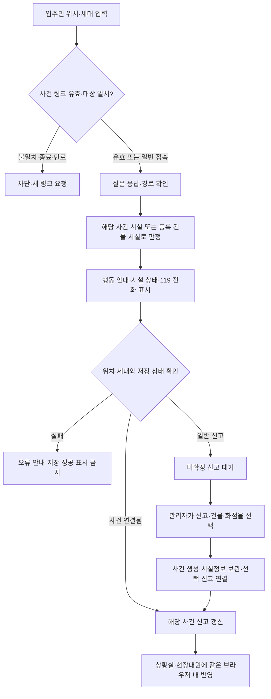
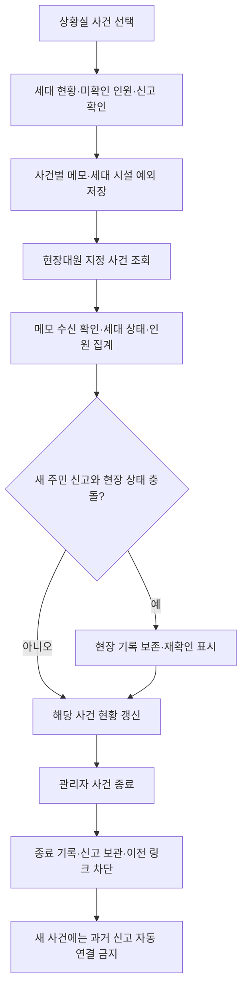
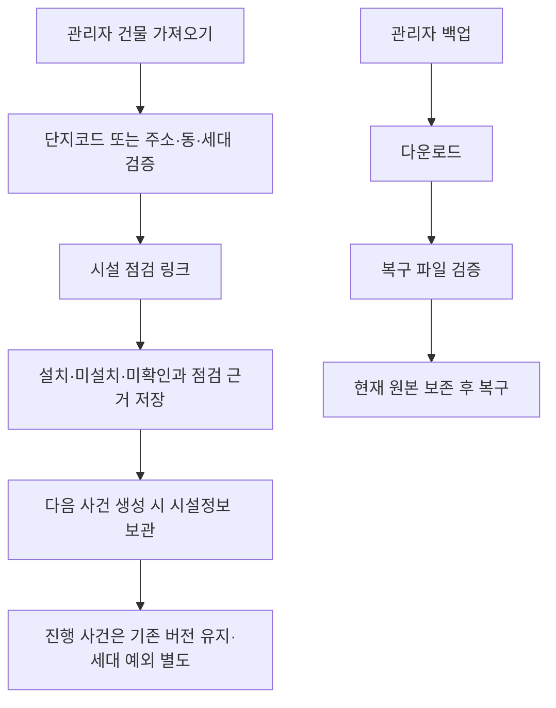

# 현재 기능별 업무 흐름

2026-09-29 로컬 개선판. 실선은 브라우저 내부 처리이며 실제 119 서버 전송을 뜻하지 않는다.

모든 저장은 실패할 수 있다. 실패 시 오류를 표시하고 이전 상태를 유지한다. 같은 브라우저의 탭 간 변경은 공유하지만 선택 사건·입주민 위치는 각 탭에 유지한다. 서로 다른 기기 사이 공유와 실제 기관 접수는 별도 구현 과제다.
